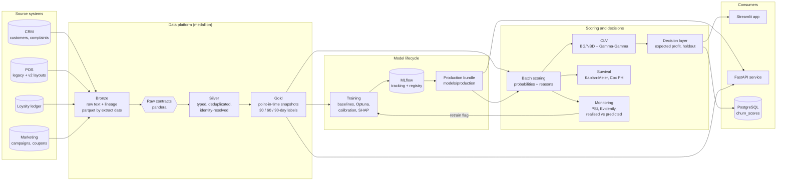
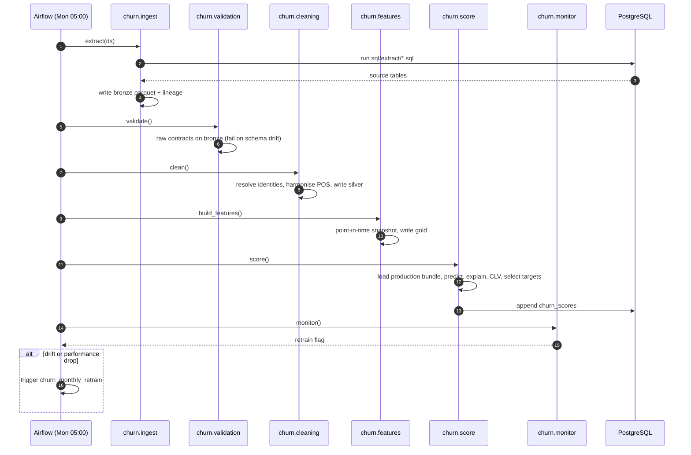
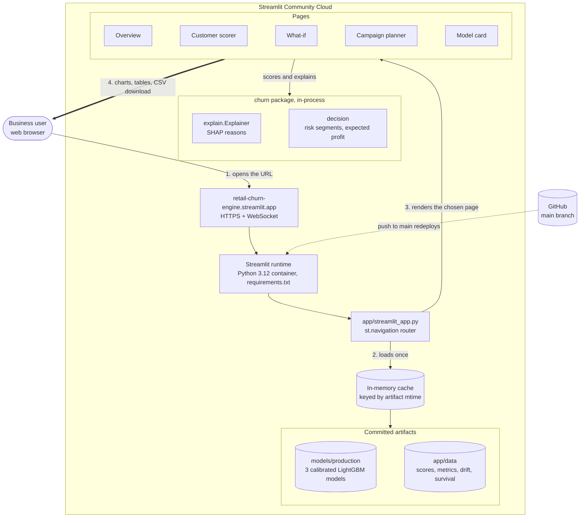
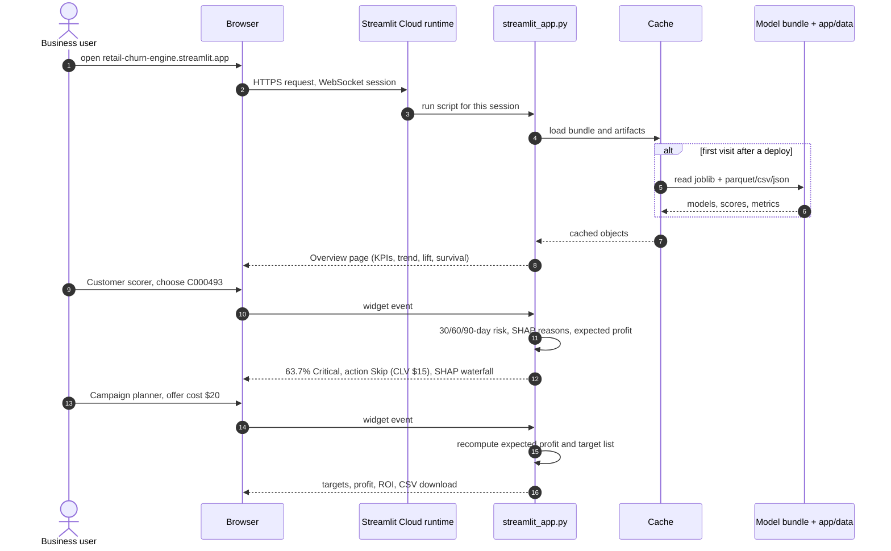
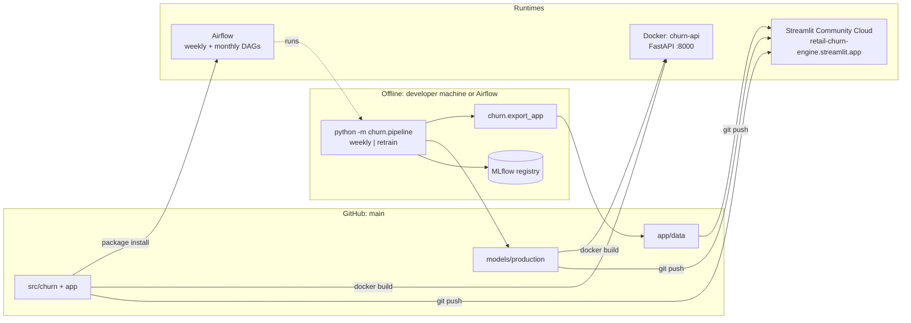

# Retail Customer Churn & Retention Engine

[](https://retail-churn-engine.streamlit.app)


**Live demo: https://retail-churn-engine.streamlit.app**

An end-to-end churn system for a grocery loyalty programme. Every week it ingests raw exports from CRM, POS, loyalty and marketing systems, cleans and resolves them into one customer view, scores each customer's probability of not buying again in the next 30, 60 and 90 days, explains every score, estimates customer lifetime value, and selects the customers worth a retention offer by expected profit. Monitoring decides when the model needs retraining.

Built on **Dunnhumby *The Complete Journey***: two years of real supermarket transactions from 2,500 households (2.6M line items, 582 stores, real campaigns and coupon redemptions), re-delivered as messy source-system exports so the cleaning layer faces production-grade problems.

---

## Contents

- [Results](#results)
- [System architecture](#system-architecture)
- [How the services call each other](#how-the-services-call-each-other)
- [From end user to interface](#from-end-user-to-interface)
- [Tech stack](#tech-stack)
- [Data engineering](#data-engineering)
- [Modelling](#modelling)
- [Decision layer](#decision-layer)
- [Monitoring and retraining](#monitoring-and-retraining)
- [Application and API](#application-and-api)
- [Deployment](#deployment)
- [Run locally](#run-locally)
- [Repository layout](#repository-layout)
- [Project status](#project-status)

---

## Results

Measured on out-of-time test snapshots the model never saw during training or selection.

| Metric | Value |
|---|---|
| PR-AUC, 60-day churn (primary) | **0.350**, base rate 0.071 (5x random) |
| ROC-AUC | 0.885 |
| Recall @ top 10% | 48.2% of churners reached by contacting 10% of customers |
| Lift @ top 10% | 4.8x |
| Brier score (calibrated) | 0.053 |
| PR-AUC, 30-day / 90-day models | 0.500 (base 0.144) / 0.219 (base 0.041) |
| Cox PH concordance (time to churn) | 0.838 |
| Identity resolution, pairwise precision / recall | 99.3% / 94.7% |
| Retention campaign | 155 customers targeted, $671 expected profit |

Model selection: Optuna-tuned LightGBM (validation PR-AUC 0.400) beat RandomForest (0.398), Logistic Regression (0.362), XGBoost (0.348) and CatBoost (0.289). Class weighting, under-sampling and SMOTE-NC did not beat the unweighted tuned model, so class imbalance is handled by probability calibration and a profit-based decision threshold.

---

## System architecture



The system is a weekly batch pipeline with an on-demand API next to it. Each stage is a Python module with a `run()` function, so the same code runs from the command line, from tests, and from Airflow tasks.

| Layer | Module | Responsibility |
|---|---|---|
| Ingestion | `churn.ingest` | Read CSV exports or PostgreSQL extracts (`sql/extract/*.sql`) as text, attach lineage, write bronze parquet partitioned by extract date |
| Contracts | `churn.validation` | Raw contracts on bronze: warn on dirty rows, fail the run on schema change or more than 2% failures. Strict typed schemas on silver |
| Cleaning | `churn.cleaning` | Identity resolution, POS harmonisation, deduplication, returns linking, outlier repair, leakage removal |
| Features | `churn.features` | Point-in-time customer snapshots every 28 days, churn labels for 30/60/90 days, survival target |
| Training | `churn.train`, `churn.modeling` | Purged out-of-time split, baselines, Optuna tuning, selection, calibration, SHAP, MLflow registration, bundle export |
| Scoring | `churn.score`, `churn.explain` | Calibrated probabilities for all horizons, top-3 plain-language reasons per customer |
| Value | `churn.clv`, `churn.survival` | Customer lifetime value, time-to-churn curves by segment, Cox model |
| Decision | `churn.decision` | Expected profit per customer, target list, random control holdout |
| Monitoring | `churn.monitor` | Feature and prediction drift, matured-label performance, uplift, retrain trigger |
| Serving | `churn.api`, `app/streamlit_app.py` | REST scoring and explanations; interactive business app |
| Orchestration | `churn.pipeline`, `dags/churn_dags.py` | CLI flows and Airflow DAGs over the same functions |

---

## How the services call each other

### Weekly scoring run



### Monthly retraining run

`churn_monthly_retrain` (1st of the month 03:00, or triggered early by monitoring): `build_features` → `train` → `score` → `monitor` → `export_app_data`.

1. `churn.train` logs every baseline and Optuna trial to MLflow, registers the selected model as `churn-60d` in the MLflow registry, and exports the calibrated models for all three horizons plus metadata to `models/production/`.
2. `churn.score` and `churn.monitor` reload that bundle, so the scores and monitoring always match the registered version.
3. `churn.export_app` writes the app's read-only artifacts to `app/data/` (no names, phones or emails).

### Request path

| Caller | Calls | Reads |
|---|---|---|
| Streamlit app | in-process `Explainer` + production bundle | `models/production/`, `app/data/` |
| Client system (CRM, marketing tool) | `POST /predict`, `POST /explain` on FastAPI | production bundle + latest gold snapshot, loaded once at startup |
| Marketing team / BI | PostgreSQL `churn_scores` table | appended by each weekly run |

---

## From end user to interface

What happens between a business user opening the URL and seeing a churn score on screen.



### A user session, step by step



Each interaction re-runs only the page script against cached objects, so responses stay fast and nothing is retrained or rescored on the hosting platform.

---

## Tech stack

| Area | Tools |
|---|---|
| Language and data | Python 3.12, Polars, pandas, NumPy, PyArrow / Parquet |
| Data acquisition | kagglehub (Dunnhumby download), Faker (synthetic identities for the source-system simulation) |
| Configuration | One YAML file (`configs/config.yaml`) loaded with PyYAML |
| Data quality | pandera (Polars raw contracts, pandas silver schemas), phonenumbers |
| Entity resolution | rapidfuzz, union-find clustering, golden-record survivorship |
| Machine learning | scikit-learn, LightGBM, XGBoost, CatBoost, imbalanced-learn (SMOTE-NC) |
| Tuning and tracking | Optuna, MLflow (tracking server on SQLite, model registry) |
| Explainability | SHAP TreeExplainer, global importance and per-customer reasons |
| Customer value and time to churn | lifetimes (BG/NBD, Gamma-Gamma), lifelines (Kaplan-Meier, Cox PH) |
| Monitoring | PSI drift, Evidently data-drift report |
| Serving | FastAPI, Pydantic v2, Uvicorn, Docker (`python:3.12-slim`, non-root, health check) |
| Application | Streamlit (multi-page `st.navigation`), Plotly |
| Hosting and delivery | Streamlit Community Cloud, GitHub (push-to-deploy) |
| Orchestration | Apache Airflow (TaskFlow DAGs, `TriggerDagRunOperator`), CLI pipeline |
| Storage | Parquet medallion layers, PostgreSQL via SQLAlchemy + psycopg2 (extracts and score table) |
| Quality | pytest, FastAPI TestClient + httpx, Streamlit AppTest, ruff |

Dependencies are split by deployment target so each runtime installs only what it needs:

| File | Installed by | Contents |
|---|---|---|
| `requirements.txt` | Streamlit Community Cloud | App only: Streamlit, Plotly, pandas, scikit-learn, LightGBM, SHAP |
| `requirements-api.txt` | Docker image | API only: FastAPI, Uvicorn, Pydantic, model runtime |
| `requirements-dev.txt` | Developers, Airflow workers | Everything: API set plus pipeline, training, monitoring and test tools |

---

## Data engineering

### Source defects and how the pipeline handles them

Dunnhumby is a curated research panel with one clean household key and no duplicates. Retail feeds are not like that, so the data is re-delivered the way four separate source systems would export it. Purchases themselves (what each household bought, when, where, and for how much) are untouched; identities, formats and system defects are introduced.

| Source defect | Pipeline answer |
|---|---|
| 6% of households registered twice (nickname or typo, reformatted phone, changed email), baskets split across both cards | Blocking on phone, email and name+store; rapidfuzz scoring with nickname folding; union-find clusters; golden record |
| Names as `SMITH, JOHN` or ` john  smith `, 7 phone formats, 3 date formats, inconsistent tier casing | Parsers, E.164 phone normalisation, validated email, canonical enums |
| POS vendor upgrade mid-stream: renamed columns, `dd/mm/yyyy` timestamps, `BR00364` branch codes, `1,234.50` amounts | Two raw contracts, one harmonised transaction schema |
| Two monthly files loaded twice (252k duplicate lines) | Deduplication on invoice and line number |
| Test store, test card, baskets without a scanned card | Excluded and counted in the cleaning report |
| Returns as negative lines, 2k without a matching sale | Flagged, linked to the original sale, orphans kept and counted |
| Prices keyed ×100 | Repaired when unit price exceeds 50x the product median |
| `account_status`, `closed_date` and current loyalty tier in the CRM export | Dropped as target leakage |

Defects in the original data are also caught: floating-point residue such as `2.22e-16` in discount columns, positive discounts (sign errors), and fuel lines recording litres as quantity.

Complaints do not exist in Dunnhumby and are generated with a higher rate in the weeks before a long lapse, so complaint features carry a known, documented signal. All other signal comes from real purchase behaviour. Identity-resolution accuracy is scored against a ground-truth card-to-household mapping that the pipeline itself never reads.

### Leakage controls

- Features use only rows dated on or before each snapshot cutoff; a test appends future data and asserts no feature value changes.
- Labels whose outcome window has not closed stay null; the latest snapshots are scoring-only.
- Purged out-of-time split: training labels close before validation snapshots begin, and validation labels close before test snapshots begin.
- Hyper-parameter cross-validation is stratified and grouped by customer, inside the training window only.
- Imputers and encoders are fitted inside the scikit-learn pipeline.

---

## Modelling

- **Snapshots:** one row per customer every 28 days; 52 features: 45 behavioural (recency, inter-purchase gaps and overdue ratio, 28/90/180-day visits and spend, trends and momentum, basket breadth, discount and coupon use, channel and timing, returns, complaints, loyalty points, campaign exposure, merged cards, tenure) plus 7 household demographics.
- **Targets:** churn = no purchase in the next 30, 60 or 90 days. 60 days is the primary horizon (90-day churn is too rare at about 4% to act on; 30-day is noisy).
- **Candidates:** Logistic Regression, RandomForest, LightGBM (no balancing, class weights, under-sampling, SMOTE-NC), XGBoost, CatBoost.
- **Tuning:** Optuna TPE on LightGBM with stratified group k-fold CV.
- **Selection:** best validation PR-AUC.
- **Calibration:** sigmoid calibration on the validation snapshots, so probabilities can be multiplied by money.
- **Explanations:** SHAP values per customer, turned into readable reasons such as "No visit in 67 days".
- **Survival:** Kaplan-Meier curves per risk segment and a Cox proportional hazards model for time to churn.

---

## Decision layer

For each customer:

```
expected_profit = P(churn) × CLV × offer_success_rate − offer_cost
```

- CLV comes from BG/NBD (purchase frequency) and Gamma-Gamma (spend per purchase), times margin.
- Customers with positive expected profit are ranked and targeted, optionally capped by budget.
- A random 10% of targeted customers form a control holdout, so uplift can be measured once outcomes mature.
- Offer cost, success rate and margin live in `configs/config.yaml` and can be changed live in the app.

A high-risk customer is not automatically a target: a customer with 64% churn risk but $15 lifetime value is skipped, because the offer costs more than the value it is expected to save.

---

## Monitoring and retraining

| Check | Rule |
|---|---|
| Feature drift | PSI per feature, latest snapshot vs training window; alert above 0.2 |
| Prediction drift | PSI of predicted probabilities vs test-period scores |
| Realised vs predicted | Once labels mature: predicted vs actual churn rate and PR-AUC per snapshot |
| Uplift | Churn of treated vs control holdout |
| Retrain trigger | PR-AUC falls more than 0.05 below baseline, more than 30% of features drift, or prediction PSI above 0.2 |

An Evidently data-drift report is generated alongside the PSI checks for visual inspection.

---

## Application and API

### Streamlit app: https://retail-churn-engine.streamlit.app

| Page | What it does |
|---|---|
| Overview | Headline KPIs, churn trend, risk segments, lift and cumulative gains, time-to-churn curves by segment |
| Customer scorer | Search any customer: churn risk for 30/60/90 days, CLV, recommended action, top reasons, SHAP waterfall, profile |
| What-if | Change a customer's behaviour (recency, frequency, spend, complaints) and see the risk respond |
| Campaign planner | Set offer cost, success rate, margin and budget; get the target list, expected profit and ROI; download as CSV; check the rule against history |
| Model card | Test metrics, model comparison, calibration, SHAP importance, survival model, cleaning report, drift and retrain status, Evidently report |

### REST API

```
GET  /health
POST /predict   {"customer_id": "C000123"}  or  {"features": {...}}
POST /explain   same body; adds top reasons and full SHAP contributions
```

```bash
curl -X POST localhost:8000/explain \
     -H "Content-Type: application/json" \
     -d '{"customer_id": "C000123"}'
```

The response holds calibrated probabilities for every horizon, the risk segment, model version and snapshot date. Validation errors return 422 (malformed ID, both or neither of `customer_id` and `features`, unknown feature names, non-numeric values, empty feature set) and unknown customers return 404.

---

## Deployment

Heavy work (cleaning, training, scoring) runs offline in the pipeline. Serving layers only load finished artifacts, so they start fast and stay cheap.



| Target | Status | How it is delivered |
|---|---|---|
| Streamlit app | Live at https://retail-churn-engine.streamlit.app | Community Cloud watches `main`; each push redeploys. Entry point `app/streamlit_app.py`, Python 3.12, `requirements.txt`, theme in `.streamlit/config.toml`. Reads 0.7 MB of model files and 7.3 MB of app data with no personal fields. Caches are keyed by file modification time, so a redeploy never shows stale artifacts. |
| FastAPI service | Image built and verified locally | `Dockerfile` installs the package without dev tools, copies the model bundle and latest snapshot, sets `CHURN_ROOT=/srv`, runs Uvicorn with 2 workers as user `api`, health check on `/health`. Ready for any container host (Cloud Run, Azure Container Apps, ECS, Kubernetes); in production, mount the latest snapshot from shared storage instead of baking it in. |
| Batch pipeline | DAG code ready | `dags/churn_dags.py` calls the same `run()` functions as the CLI. Needs an Airflow deployment, `DATABASE_URL` for the source PostgreSQL, shared storage for `data/` and `models/`, and a shared MLflow server. |

**Releasing a new model or new weekly scores to the live app:**

```bash
python -m churn.pipeline retrain       # or: weekly
pytest -q
git add models/production app/data
git commit -m "Refresh model and scores"
git push origin main                   # Community Cloud redeploys
```

---

## Run locally

```bash
python -m venv .venv
source .venv/bin/activate               # Windows: .venv\Scripts\activate
pip install -r requirements-dev.txt
pip install -e .

python -m churn.download                # Dunnhumby from Kaggle into data/raw/dunnhumby
python -m churn.pipeline all            # simulate exports, weekly flow, retrain flow
pytest -q
```

| Service | Command |
|---|---|
| Streamlit app | `streamlit run app/streamlit_app.py` |
| FastAPI | `uvicorn churn.api:app --port 8000` |
| FastAPI in Docker | `docker build -t churn-api . && docker run -p 8000:8000 churn-api` |
| MLflow UI | `mlflow ui --backend-store-uri sqlite:///mlflow.db` |
| Weekly flow only | `python -m churn.pipeline weekly` |
| Retrain flow only | `python -m churn.pipeline retrain` |

With `DATABASE_URL` set, `python -m churn.ingest --source postgres` extracts from PostgreSQL and scoring appends to the `churn_scores` table.

---

## Repository layout

```
.
├── app/
│   ├── streamlit_app.py            5-page Streamlit app (Overview, Customer scorer, What-if, Campaign planner, Model card)
│   └── data/                       read-only artifacts for the app, written by churn.export_app
├── configs/
│   └── config.yaml                 every parameter: paths, calendar, simulation rates, horizons, cutoffs, split, offer economics, Optuna
├── dags/
│   └── churn_dags.py               Airflow: churn_weekly_scoring, churn_monthly_retrain
├── models/
│   └── production/                 churn_model.joblib (3 calibrated models + SHAP base model) and metadata.json
├── sql/
│   └── extract/                    one extract query per source table (CRM, POS legacy/v2, loyalty, marketing, products)
├── src/churn/
│   ├── config.py                   YAML config with attribute access, path resolution, logging
│   ├── download.py                 Dunnhumby download from Kaggle
│   ├── simulate/exports.py         re-delivers Dunnhumby as messy CRM, POS, loyalty and marketing exports
│   ├── ingest.py                   CSV or PostgreSQL sources into bronze parquet with lineage
│   ├── validation.py               pandera raw contracts (Polars) and strict silver schemas (pandas)
│   ├── cleaning/
│   │   ├── customers.py            name/phone/email/date parsing, blocking, fuzzy matching, union-find, golden record
│   │   ├── transactions.py         POS harmonisation, dedup, test-data removal, returns linking, price repair
│   │   └── run.py                  builds silver tables and the cleaning report
│   ├── features.py                 point-in-time snapshots, 30/60/90-day labels, survival target
│   ├── modeling.py                 purged out-of-time split, model factory, imbalance strategies
│   ├── metrics.py                  recall and precision at k, lift and reliability tables, metric report
│   ├── train.py                    baselines, Optuna, selection, calibration, SHAP, MLflow registry, bundle export
│   ├── explain.py                  SHAP values and plain-language reasons
│   ├── clv.py                      BG/NBD + Gamma-Gamma customer lifetime value
│   ├── survival.py                 Kaplan-Meier by segment, Cox proportional hazards
│   ├── decision.py                 risk segments, expected profit, target selection with control holdout
│   ├── score.py                    weekly batch scoring and PostgreSQL write-back
│   ├── monitor.py                  PSI drift, prediction drift, realised vs predicted, uplift, retrain trigger, Evidently
│   ├── export_app.py               copies app artifacts with personal fields removed
│   ├── api.py                      FastAPI service: /health, /predict, /explain
│   └── pipeline.py                 CLI flows: weekly, retrain, all
├── tests/
│   ├── test_cleaning.py            parsers, identity resolution, transaction cleaning
│   ├── test_features_split.py      point-in-time correctness, purged split
│   ├── test_api.py                 endpoints and input validation
│   └── test_app.py                 every app page renders without errors (AppTest)
├── .streamlit/config.toml          app theme and server settings
├── Dockerfile, .dockerignore       API image
├── requirements.txt                Streamlit Cloud dependencies
├── requirements-api.txt            API image dependencies
├── requirements-dev.txt            full pipeline, training and test dependencies
├── pyproject.toml                  package definition, ruff and pytest settings
├── architecture.md                 scope and design
└── checkpoint.md                   project status, deployment strategy, open items
```

Generated locally by the pipeline and not committed:

```
data/
├── raw/dunnhumby/                  original Kaggle CSVs
├── exports/                        simulated source-system exports (crm, pos, loyalty, marketing, catalog)
├── bronze/<table>/extract_date=…/  raw text parquet with lineage
├── silver/                         customers, card_map, identity_links, transactions, baskets, complaints, points, campaigns
├── gold/                           snapshots, churn_scores, target_list, survival tables
└── reports/                        validation, cleaning, training and monitoring reports
mlflow.db, mlruns/                  MLflow tracking store and artifacts
```

---

## Project status

Component status, deployment details and open items are tracked in [checkpoint.md](checkpoint.md).
